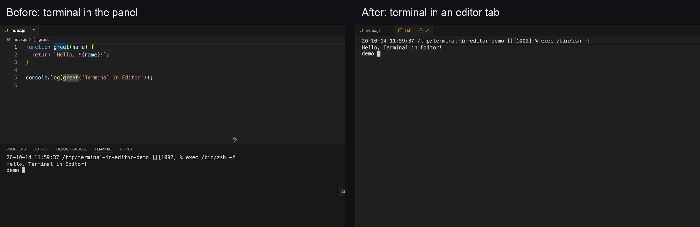

# Terminal in Editor

Put your integrated terminal in an editor tab with one click. Keep it beside
your code, split it into another editor group, or give it the full editor area.

## Use it

Click **Terminal** on the right side of the status bar.

You can also open the Command Palette (`Cmd+Shift+P` on macOS,
`Ctrl+Shift+P` on Windows/Linux) and run **Terminal: Attach to Editor**.

## What happens

- **Terminal already open:** moves the active terminal into an editor tab,
  keeping its shell session and output.
- **No terminal open:** creates a new terminal directly in the editor area.

Uses VS Code's built-in terminal. No settings or extra dependencies.

## Install

Search for **Terminal in Editor** by **Talha Khalil** in VS Code's Extensions
view. Requires VS Code 1.109.0 or later.
